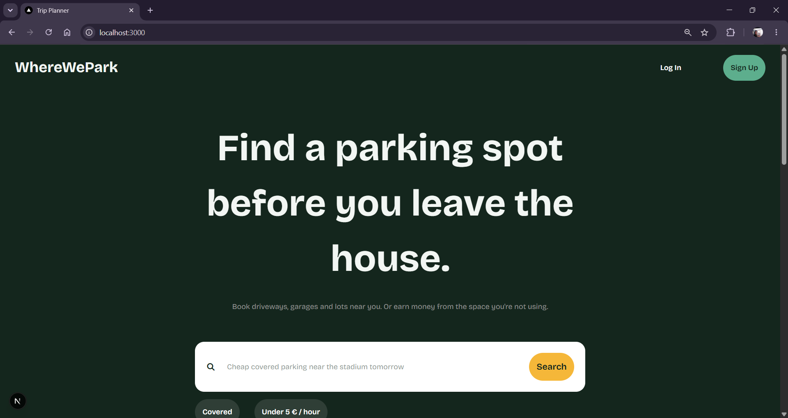

# WhereWePark
WhereWePark is a parking rental platform that connects parking spot owners with drivers looking for convenient parking.



🔗 **Live demo:** https://where-we-park.vercel.app/

## Tech Stack

React · Next.js · TypeScript · Node.js · PostgreSQL

## Features

**Owners:**
- Add and list parking spots.
- View all owned parking spots.
- Manage incoming bookings.

**Drivers:**
- Browse available parking spots.
- Book parking spots.
- View booking history and upcoming bookings.
- Save parking spots to favorites.

## Authentication & Security

- JWT authentication with cookie-based token storage.

## Currently Working On

- Reviews & Ratings 
- Error Handling 
- Dashboard & Statistics 
- Editing Functionality 
- Map Integration 

## Getting Started

```bash
git clone https://github.com/your-username/wherewepark
cd wherewepark
npm install
npm run dev
```

Create a `.env` file:

```
DATABASE_URL=
JWT_SECRET=

```
